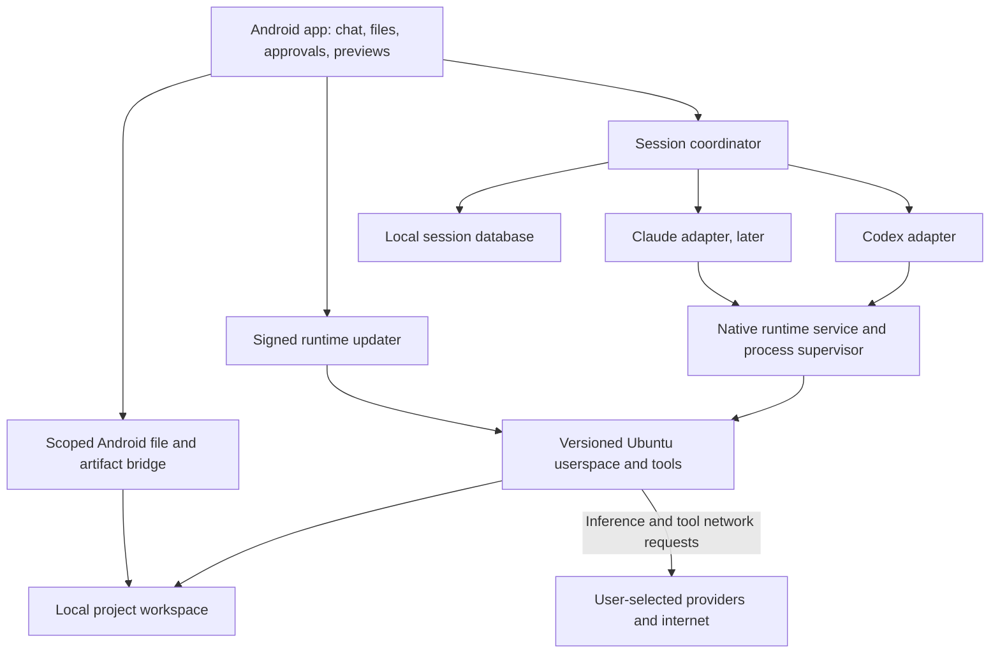

# On-device agent workspace: Keva analysis and implementation design

Research date: 2026-10-17. Status: architecture proposal; no Android application or
embedded runtime has been implemented or tested by this analysis.

## Decision

Build a separate **phone-use Workspace** Android application: a local project
workspace, a minimal ARM64 Ubuntu userspace, and an interface to an existing coding
agent. Start with Codex app-server; add Claude Code behind a second adapter after
the executable/runtime feasibility gate passes. The name is a working name.

The desired experience is: install an APK, provision a verified runtime pack, sign
in to an agent provider, import or clone a project, ask for work, inspect tools and
changes, then open or export the result. Everyday operation needs no root, PC or
hosted desktop. Developer builds can still run on AWS.

Keep the existing Python MCP/CLI model-free. It provides Android device controls;
the new app hosts an agent and its computer environment. Neither role implies the
other. A normal app hosting Linux does not automatically gain access to other apps,
their private files, or the ability to tap their screens.

Use a headless Ubuntu userspace first. A separate Linux kernel, desktop session,
Docker daemon and systemd are outside the initial scope. Treat Omarchy as a possible
source of product/UI ideas, not as the runtime image to install on Android.

## What Keva establishes

Keva's website advertises local files, shell tools, Git, web research, two coding
agents, and previews of generated artifacts. It specifies ARM64 Android and roughly
4–5 GB storage. Its public GitHub repository is for documentation/releases, not the
proprietary application source. These are product claims, not our device-test results.
[Product](https://keva.chat/), [public repository](https://github.com/SimonLeen22/keva-app).

The technical paper reports a Flutter/Kotlin app bundling Ubuntu, with Claude
launched through the glibc loader after PRoot/Bun JIT conflicts. It reports
`targetSdk=28` for app-private executable support, and process-lifecycle recovery
work. Model inference is remote. Its source-file references cannot be audited from
the closed-source application. These details guide experiments; they do not prove
our launcher or a current Android version will work.
[Keva paper](https://keva.chat/paper/).

Keva currently lists a seven-day trial and a one-time license for two devices:
$19.90 for the first 100 buyers and $39.90 standard. Provider usage is separate.
Do not carry over Tapkit's monthly pricing assumption to this product category.
[Pricing](https://keva.chat/pricing/).

### Features to implement

| User outcome | First implementation | Later expansion |
| --- | --- | --- |
| A usable computer on the phone | Shell, Git, Python, basic file tools, Node where needed | Additional tested tool packs |
| Work through a conversational interface | Codex events, tool cards, approvals, stop/resume | Claude adapter, cross-engine context summary |
| Keep project files locally | App-private workspaces, import/export through Android picker | User-selected folder synchronization |
| Inspect actual results | File list, text/diff viewer, isolated HTML preview | Images, PDFs and richer media preview |
| Work with a repository | Clone, status, diff, local commits; explicit remote push | PR workflow and signed commits |
| Recover interrupted work | Durable session/run state and restart reconciliation | Longer background jobs and schedules |
| Understand resource use | Storage breakdown, runtime version, active-job status | Thermal/battery controls and per-tool resource reporting |
| Use existing agent access | Official provider authentication inside the adapter | Additional compatible providers, validated separately |

Start with a single engine active per workspace. Preserve actual runtime thread IDs
and transcripts; switching engines later should use a visible context summary rather
than pretending their internal sessions are interchangeable.

## Runtime choices

| Choice | Benefit | Cost or limitation | Decision |
| --- | --- | --- | --- |
| Ubuntu ARM64 userspace | glibc and familiar tools; aligns with agent Linux distributions | Requires an Android launch/path strategy | Primary runtime experiment |
| Debian minimal ARM64 | Similar glibc compatibility with a small base | Same Android restrictions | Fallback if measured size/compatibility is better |
| Alpine ARM64 | Small base | musl and package differences add another compatibility dimension | Defer until agents and required tools are validated |
| Termux native tools | Mature Android-native userspace | Separate-app dependency or substantial packaging/fork work | Useful prototype/reference, not silently required by final app |
| PRoot filesystem translation | A conventional Linux path view without root | ptrace overhead, no kernel isolation; runtime/JIT compatibility must be tested | Baseline candidate for Codex/tools |
| Direct glibc loader | Avoids tracing the engine | Does not translate `/bin`, `/usr`, shebangs, child exec or library discovery automatically | Parallel design candidate; prove complete subprocess chain |
| Omarchy desktop | Full desktop/developer experience | Desktop boot/install and graphics/service assumptions exceed a normal app's needs | Exclude from MVP |
| AVF virtual machine | Potentially stronger guest separation | Device-specific support and permission/API constraints | Optional future backend |

PRoot's own documentation describes syscall translation rather than namespaces or
cgroups; real root operations and full init systems are unavailable. A successful
PRoot install is not evidence of a secure container boundary.
[PRoot-Distro](https://github.com/termux/proot-distro#limitations).

Omarchy's documented installation boots an ISO and installs onto disk. That is a
different product from an Android app hosting command-line tools. We should not run
its installer against a phone workspace or claim it is a drop-in mobile userspace.
[Omarchy installation](https://omarchy.org/manual/getting-started/).

AVF's Java APIs are optional and available only on supporting devices. Do not use
it as the universal no-root baseline.
[Android Virtualization Framework](https://source.android.com/docs/core/virtualization).

## The distribution decision must precede the full app

Android documents that apps targeting API 29+ cannot directly `execve()` binaries
from their writable home directory. A downloaded Ubuntu rootfs plus `chmod +x` is
therefore not a complete solution for a modern-target APK.
[Android executable restrictions](https://developer.android.com/about/versions/10/behavior-changes-10#execute-permission).

Two distinct tracks:

1. **Direct-download research APK:** test a target-28 variant on supported devices
   as a bounded compatibility experiment. Label its legacy-target tradeoff and
   install behavior. Do not assume it will remain supported indefinitely.
2. **Modern-target distribution:** test packaged native executables and compatible
   runtime loading with current Android policy. Proving one packaged ELF executes
   does not prove package installation, arbitrary compiled binaries or a complete
   coding-agent toolchain works. If this track fails, report the limitation; do not
   silently substitute a cloud desktop.

For general new-app submissions, Google's current page requires target API 36 from
August 31, 2026, with stated exceptions/extensions. A target-28 prototype is not a
Play-ready release. Store acceptance also requires review beyond the target number.
[Current target requirements](https://developer.android.com/google/play/requirements/target-sdk).

The first engineering milestone is choosing a tested execution/distribution route,
not building a polished chat screen around an unproven launcher.

## Proposed architecture



**Application:** Kotlin with Jetpack Compose, Room for metadata and a native process
service. This project has no existing Android UI framework to preserve; Kotlin
keeps runtime, files, permissions and lifecycle in one platform. Flutter with a
Kotlin bridge is a viable alternative if a shared cross-platform UI becomes a goal.

**Runtime service:** own stdout/stderr separately, bounded pipes, process groups,
cancellation, timeouts and restart state. Keep agent protocol output separate from
shell logs. Maintain a generation identifier so late output cannot complete a new
run. Use a visible foreground service only while work is active; checkpoint before
backgrounding. A notification/wake lock cannot guarantee survival under Android or
OEM resource pressure.
[Foreground services](https://developer.android.com/develop/background-work/services/fgs).

**Runtime pack:** versioned base image plus tested tools. Pin provenance, architecture,
size, hashes and licenses; use a signed manifest with a built-in verification key.
Support resumable downloads, bounded extraction, path/symlink validation, low-storage
checks, atomic activation and rollback. An update must not replace a binary while
an agent is executing it. Keep workspaces separate from runtime versions.

**Packaging:** use a small app plus optional signed runtime pack for the first
product, with a bundled offline installer as a later distribution option. The
first setup can need network; ordinary local tools can then work offline. Online
models still need network. Measure the final footprint before publishing requirements.

**Local storage layout, proposed:**

```text
files/
  runtime/versions/<manifest-id>/   # Verified immutable installed tool pack
  workspaces/<workspace-id>/       # User projects, separate from updater
  sessions/                       # Runtime session files
  run-state/                      # Durable identity and execution state
cache/
  downloads/                      # Bounded and resumable
  previews/                       # Disposable, no credentials
```

Reserve an initial testing budget of 8 GB free storage and 6–8 GB device RAM; these
are conservative test targets, not established minimum requirements. Avoid desktop
packages and make large dependencies explicitly visible before downloading them.

## Agent integration

### Codex first

Use `codex app-server --listen stdio://` under the selected local runtime. Its
documented client protocol covers initialization, threads, turns, event streaming,
approvals and authentication. Generate schemas from the pinned binary; match IDs
and terminal statuses rather than parsing terminal output. Use the managed browser
or device-code login if available to the user's account, or the documented API-key
flow. Login success alone does not prove model entitlement or command execution.
[Official app-server documentation](https://learn.chatgpt.com/docs/app-server).

First adapter sequence: initialize → initialized → account state/login → thread
creation → turn → tool/approval events → final status. Persist the thread ID. On
restart, reconcile state before resuming. Unknown, failed and interrupted turns
must not become successful completions.

The Linux distribution's availability is not proof of Android compatibility. Test
Codex's command runner and sandbox support on the actual device. Do not silently
turn off sandboxing or approvals to obtain a passing demo. If desktop sandbox
primitives are unavailable, expose the precise app-level boundary and decide whether
an acceptable restricted execution route exists before release.

### Claude second

Integrate a pinned, unmodified Claude Code distribution via its supported structured
streaming interface. Validate child-process execution and permissions independently
of Codex. Anthropic lists Linux ARM64 but not Android among its standard platforms;
current npm installation delivers the native executable, so npm alone does not
remove the compatibility problem.
[Setup](https://code.claude.com/docs/en/setup),
[programmatic interface](https://code.claude.com/docs/en/headless).

Anthropic's current product-embedding guidance allows running its unmodified binary
under its stated commercial conditions, requires users' own provider credentials,
and forbids intermediating or reselling their Claude usage. Preserve its supported
authentication methods and verify terms again before distribution.
[Embedding guidance](https://code.claude.com/docs/en/legal-and-compliance).

No model API credential is needed to author this design or test protocol parsing.
Real inference acceptance requires the user's authorized provider session; never
copy this development machine's credentials into an APK or test fixture.

## Files, privacy and permissions

The accurate promise is: **projects and execution are local; content needed for a
task may be sent to the selected model provider and other tools the user enables.**
Agent-read file excerpts and tool outputs may enter model context without the user
manually attaching those files. Local storage does not mean offline inference or
that file contents never leave the device. Keva's own privacy page distinguishes
local storage, provider traffic and license/update metadata.
[Keva privacy](https://keva.chat/privacy/).

- Import/export through Android's Storage Access Framework. A document URI is not
  a normal POSIX path: start with explicit copies into a workspace, then export
  changes with conflict confirmation. Do not promise arbitrary live folder mounts.
  [Android file access](https://developer.android.com/training/data-storage/shared/documents-files).
- Do not request broad storage access or expose all photos/contacts by default.
  These require separate scoped integrations and meaningful user authorization.
- Keep provider secrets and Git credentials out of logs, run exports, previews,
  crash reports and Android backup. Use Keystore-backed storage where the provider
  integration supports it; document unavoidable runtime-readable material.
- The engine and tools running under the same Android UID are not isolated from
  each other's app-private files. Encryption at rest does not protect a credential
  while the authorized runtime can read it. Avoid promising hard per-project or
  per-tool isolation until it is implemented and adversarially tested.
- Render approval cards from structured protocol data. Deny or stop unresolved
  requests after disconnect; do not auto-accept because the UI is absent.
- Preview generated HTML in an isolated WebView without a privileged JavaScript
  bridge or unrestricted file access. Treat generated artifacts as untrusted code.
- Prevent orphan work from being marked complete or replayed after interruption.
  Verify process identity before stopping old children; a saved PID alone is unsafe.
- Offer explicit local deletion/export and storage accounting. Runtime cleanup must
  never sweep workspaces, credentials or unrelated project files.

## How this connects to phone-use

Current main is `cc7d4aa` at research time. It contains the existing Python toolkit
and Cloudflare relay, not an Android application. Its latest validation record
includes a September 29 physical-phone screenshot-guided workflow through the
production relay. The older subscription draft predates that result.
[Current validation record](../DONE.md).

Proposed boundaries:

- Existing `src/phone_use/`: retain deterministic Android tools and no embedded LLM.
- New `apps/android-workspace/`: application, local sessions, native service and UI.
- New `runtime/`: reproducible pack recipes, manifests and launcher contracts;
  actual runtime binaries and rootfs archives stay out of Git.
- New `protocol/`: pinned agent schema versions and synthetic protocol fixtures.
- Optional future Android control provider: a separately authorized device-control
  integration. A Linux runtime does not grant ADB shell authority. Investigate
  user-authorized wireless ADB or a purpose-built Android API/accessibility service
  separately; either has permission and compatibility requirements.

The first standalone app must work without the hosted relay. Later, the relay may
provide optional remote access, using new narrowly scoped authorization rather than
extending the existing phone-control grant to arbitrary shell execution.

## Implementation sequence and acceptance gates

These are founder-sized planning estimates, not delivery commitments. See the
[runtime spike checklist](on-device-linux-spike.md) for exact evidence to collect.

| Phase | Estimated effort | Deliverable and acceptance |
| --- | --- | --- |
| 0. Runtime feasibility | 3–5 engineering days | Test APK executes the complete shell/Python/Git/agent subprocess chain on ARM64; choose launcher and distribution route |
| 1. Workspace shell | 1–2 weeks | Signed-pack provisioning, workspace import/export, foreground job service, stop and recovery; no chat claims yet |
| 2. Codex vertical slice | 1–2 weeks | Provider login, real turn, visible command approval, edited artifact, verified result and resumed session on a phone |
| 3. Claude and hardening | 1–2 weeks | Second real adapter, permission handling, low-storage/update rollback and interrupted-process tests |
| 4. Private beta | 1–2 weeks | Independent installs on multiple vendors/Android versions; device-specific battery, stability and storage report |

First useful end-to-end demo: start with a fresh install, provision the runtime,
authenticate, clone a public fixture repository, ask the agent to fix a failing
Python test, approve the command, see the test pass, inspect the diff, make a local
commit and reopen the same workspace after restarting the app. No PC is required
to operate the installed app. Git push is a separate explicitly authorized step.

Defer GUI Linux desktops, system containers, unrestricted Android app automation,
hardware video encoding, simultaneous engines and background schedules. Each creates
a separate compatibility problem and is unnecessary to prove the main user outcome.

## Open source and business model

Preserve the MIT toolkit. Publish our runtime launcher, pack recipes and compatibility
results; keep agent binaries under their own upstream terms. Do not copy Keva's
proprietary implementation. If reusing Termux or PRoot components, retain their
component-specific licensing and distribution obligations instead of relabeling the
combined product MIT. Termux's app repository is GPLv3 with specific exceptions.
[Termux license](https://github.com/termux/termux-app/blob/master/LICENSE.md).

The business now has two distinct offers: local agent Workspace and optional managed
services. Test a one-time local-app/support offer against a monthly plan for genuine
ongoing services such as encrypted sync, authorized remote access and team features.
Keep the local runtime usable without a mandatory cloud account. Model usage remains
paid directly by the user. Do not sell an unlimited-model bundle or charge a
subscription merely for executing existing open-source tools.

## Execution status for this analysis

- Read current first-party product, Android and agent documentation; no Keva APK
  downloaded, installed, purchased or decompiled.
- Checked AWS reachability, memory, disk, SDKs and workload. The existing x86_64 host
  has build capacity and installed Android SDK/NDK toolchains, but no `/dev/kvm`;
  acceleration check reports missing virtualization support. An existing emulator
  and phone-use bridge belong to ongoing work and were not changed.
- No local runtimes, toolchains or virtual devices installed. No personal device
  operated. ARM64 Android execution, background survival and inference remain untested.
- This document and the spike checklist are the delivered implementation design.
  A runtime-only APK is the next engineering artifact; it must pass the feasibility
  gate before a complete agent app is claimed.
