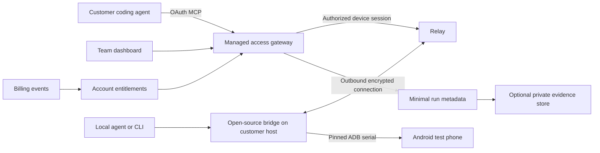

# phone-use: open source and subscription launch plan

Prepared 2026-09-28. Research and proposed decisions, not shipped capabilities or
validated demand. Planning assumption: one full-time founder, existing Cloudflare
relay, customer-owned Android devices and existing customer agent subscriptions.

Historical snapshot: the later [on-device Workspace proposal](on-device-linux-plan.md)
evaluates a standalone Android app and separate local-app economics. For current
validation evidence, use [DONE.md](../DONE.md), including the subsequent September 29
physical-phone demo; the earlier hosted-workflow status below is dated.

## Recommendation

Keep **phone-use** as the MIT-licensed, model-free Android control toolkit. Launch
**phone-use Cloud** as an optional subscription for managed device access and team
app-check workflows. Start with small Android teams and agencies already using
coding agents. Their recurring job is checking a build on real devices and sharing
clear results with colleagues.

Suggested positioning: **Your coding agent, connected to your team's Android phones.**

The first paid outcome: a developer can connect a designated test phone, authorize
a teammate's agent, run an agreed app check, inspect the result, and repeat it after
the next build. Start with bring-your-own-device; the customer's computer must
remain online. Keep reasoning and model costs in the customer's agent.

Tapkit demonstrates a comparable offer and a public price anchor. It does not
establish demand, retention, revenue, or willingness to pay for our Android product.
The durable advantage to pursue is dependable setup, useful verification evidence,
and repeated team use. Basic taps and screenshots are already widely available.

## 1. Evidence and limitations

Tapkit's [website](https://www.tapkit.ai/) lists **$49/month per iPhone**, $245 for five,
and fleet onboarding. It currently describes customer-owned iPhones connected to
a Mac, with hosted hardware being explored. These are vendor claims; no Tapkit
subscription was purchased and no device workflow was tested for this review.

The supplied [launch post](https://x.com/tj_littlejohn/status/2104614327802282271)
returned HTTP 403; searches did not recover its exact contents. Launch date,
video demonstrations, engagement, and launch-specific promises remain unverified.
The feature inventory below comes from accessible first-party product documentation.

Current phone-use baseline, inspected in [README](../README.md),
[validation record](../DONE.md), [bridge](../src/phone_use/bridge.py), and
[relay](../cloudflare/src/index.ts):

- Implemented: 13 MCP tools, matching JSON CLI, skill, Android ADB backend,
  structured UI observations, snapshot-checked taps, and an optional OAuth relay.
- Historical device evidence: a complete local Android 9 emulator workflow.
  Full hosted UI validation failed in the recorded attempts. Synthetic relay tests
  passed. None of those device runs were repeated for this planning exercise.
- Missing business capabilities: durable customer accounts, organizations,
  subscriptions, team device permissions, durable device registry, and run history.
  Current pairing identifies a temporary device session, not a paying customer.
- Limitations: ASCII input, no iOS support, no verified broad physical-device matrix,
  no desktop onboarding app. The bridge requires a host with ADB access.
- The validation record describes a downloadable plugin and an unsubmitted directory
  draft. This plan does not assume directory approval or current production readiness.

The existing [YC preparation draft](yc-readiness.md) also favors Android app teams.
This plan adds competitor evidence, packaging, and delivery gates to that hypothesis.

## 2. Extracted features and decisions

“Documented” means described by Tapkit, not independently exercised. Priorities:
P0 = paid pilot prerequisite; P1 = after initial paid use; P2 = demand-gated expansion.

| Capability | Tapkit evidence | phone-use today | Decision |
| --- | --- | --- | --- |
| Physical device connection | iPhone through Mac; USB, trust and Bluetooth setup. [Setup](https://docs.tapkit.ai/setup) | Android through ADB; explicit authorization | P0: Android-first setup diagnostics; retain explicit authorization |
| Guided desktop setup | Installer, permission checks, connection troubleshooting, updates. [Mac app](https://docs.tapkit.ai/mac-app) | CLI instructions | P0: guided CLI and web checklist; P1: desktop wrapper if setup blocks activation |
| Remote MCP | Hosted Streamable HTTP, OAuth consent. [MCP](https://docs.tapkit.ai/integrations/mcp) | OAuth relay exists experimentally | P0: complete real-device validation and account-bound access |
| Screen and touch | Screenshots and a range of tap/drag gestures. [MCP tools](https://docs.tapkit.ai/integrations/mcp) | PNG, taps, swipes, long press via swipe | Keep primitives OSS; add gestures only for a demonstrated workflow |
| Structured observation | Published MCP list centers on screen coordinates; no UI-tree tool listed. [MCP tools](https://docs.tapkit.ai/integrations/mcp) | UI tree, find elements, stale-snapshot protection | Retain as OSS strength; benchmark usefulness, avoid superiority claims |
| Text input | MCP documents US-ASCII, maximum 100 characters. [MCP tools](https://docs.tapkit.ai/integrations/mcp) | Printable ASCII, up to 2,000 characters, explicit exclusions | P1: investigate optional Unicode support; ship only after exact round-trip checks |
| REST and asynchronous jobs | HTTP control, job IDs and polling. [API](https://docs.tapkit.ai/api-reference/introduction) | MCP and CLI; no public device REST API | P1: typed REST wrapper using the same schemas, when integrations need it |
| Device registry | Names, host/status and active subscription slots. [Web app](https://docs.tapkit.ai/web-app) | Temporary paired session, pinned serial | P0: stable opaque device IDs and entitled device slots |
| Team access | Invitations, Member/Admin roles and organization sharing. [Web app](https://docs.tapkit.ai/web-app) | No team account model | P0: owner/operator/viewer roles and per-device grants |
| Remote viewing | Browser stream and manual gestures; one stream per Mac. [Web app](https://docs.tapkit.ai/web-app) | Agent screenshots; no viewer | P0: on-demand preview and revoke; P1: live view and exclusive human takeover |
| Billing | Per-phone subscriptions and billing portal. [Web app](https://docs.tapkit.ai/web-app) | None | P0: one team pilot plan and hosted checkout/portal |
| Skills and integrations | General and app-specific skills alongside MCP. [Integration guide](https://www.tapkit.ai/integrations/mcp) | General skill and plugin package | P0: three original Android app-check recipes, kept OSS |
| Built-in agent | Mac chat uses a hosted model. [Architecture](https://docs.tapkit.ai/how-it-works) | Host agent owns planning | Defer: maintain the model-free package and use customer agents |
| Screenshot handling | MCP/API screenshots stored by Tapkit; provider also receives requested images. [Security](https://docs.tapkit.ai/security) | Relay intentionally does not persist screen payloads | Preserve transient default; add optional, bounded evidence storage |
| Consumer cross-app tasks | Messaging, purchases and verification advertised. [Website](https://www.tapkit.ai/) | Basic controls; task success varies | P2: expand only from observed demand and explicit task authorization |
| Hosted hardware / iOS | iPhone BYOD now; hosting described as exploratory. [Website](https://www.tapkit.ai/) | Android BYOD; no iOS | P2: partner/adapter evaluation after paid retention |

Do not inherit broad homepage claims as acceptance criteria. For example, Tapkit's
[setup guide](https://docs.tapkit.ai/setup) says it cannot unlock a locked phone,
despite the homepage's broader lock/unlock wording. Neither product should imply
authentication bypass or universal app compatibility.

Two adjacent alternatives also matter: [mobile-harness](https://github.com/droidrun/mobile-harness)
documents Android/iOS/local/cloud access, while
[mobile-mcp](https://github.com/mobile-next/mobile-mcp) documents cross-platform MCP,
accessibility inspection and device actions. “MCP,” “no extra model key,” and
“accessibility-first” are not sufficient differentiators by themselves.

### Finish the extraction with a bounded hands-on study

Before implementing expensive parity, run a separate authorized trial on dedicated
test hardware. Budget one day after obtaining a subscription and test iPhone/Mac.
No purchase or device operation is part of this planning task.

1. Record clean-install setup, first screenshot, first verified task, failure recovery,
   second-phone setup, teammate access, revocation and cancellation.
2. Use neutral fixture tasks: form entry and verification, scroll-to-item, navigation,
   connection loss, and simultaneous human/agent access. Avoid personal accounts.
3. Capture duration, human interventions, supported versions and outcome. Compare
   equivalent app flows; report platform/hardware differences rather than ranking
   unlike devices by raw latency.
4. Update this matrix with `documented / observed / failed / unknown`, source date,
   minimal evidence and a customer problem each proposed feature would solve.
5. Implement original behavior and copy. This is public product research, not a
   request to extract proprietary source, private APIs, or protected assets.

## 3. What stays open source, and why customers pay

| Area | Free phone-use | Paid phone-use Cloud |
| --- | --- | --- |
| Device operations | All current and future core Android primitives, MCP/CLI, safety fixes | Hosted delivery of the same operations |
| Reasoning | User's chosen agent; no phone-use model calls | Same boundary; agent subscription/usage paid separately |
| Connection | Local stdio, CLI, bridge and existing relay source remain available | Managed endpoint, device registry, account recovery and operations |
| Team workflows | Local recipes and portable report format | Shared devices, per-device grants, run index and team dashboard |
| Evidence | Local export under user control | Opt-in storage, private links, retention and deletion controls |
| Reliability | Public fixes and compatibility results | Monitoring, supported configurations, onboarding and support |
| Automation | Local scripts and customer-owned runner | Later: schedules and team routing to that runner |

Keep the existing repository and MIT license. Do not move already-public relay code
behind a paywall. Publish self-host instructions and keep local use independent of
account, billing, and telemetry services. Develop the commercial account/billing
dashboard separately, with a documented protocol and versioned shared core.

Maintain one implementation of device operations. Improvements needed for correctness
and security go into the public core. Reserve roughly one day per week for public
issues, releases, recipes and compatibility work once pilots start.

Customers can self-host; the subscription earns its place through reduced setup and
operating work. Avoid a plan whose only value is an API key for existing free taps.
Offer export and straightforward cancellation so customers can keep using local tools.

Treat the existing experimental hosted endpoint as a migration concern: keep its
documented session behavior while piloting a separate account-based route. Announce
any future limits or retirement with a migration path; do not silently turn existing
pairings into subscriptions or lengthen their eight-hour authority.

## 4. Initial customer and paid MVP

**Primary buyer:** a founder, engineering lead or agency lead in a small Android team
already using coding agents and repeating manual release checks every week.
**User:** the developer checking a build on designated test phones.

Interview ten such teams. Ask them to show the last manual check, how often it repeats,
which devices it needs, who owns the hardware, what failures cost, and what they
already tried. Ask for a trial using their next real build and a $99/month decision.
Expressions of interest are weaker evidence than repeat usage and received payment.

Three initial recipes, implemented against owned or consented test apps:

- Fresh launch → navigate onboarding → verify an expected screen.
- Enter fixture text → submit a non-sensitive form → verify displayed/persisted result.
- Navigate a scrollable list → select an item → go back → verify restored state.

Build MVP around a narrow sequence:

1. Sign in, create workspace, connect an explicitly chosen test phone.
2. Run diagnostics for ADB, authorization, online status and supported capabilities.
3. Connect the coding agent with OAuth and run a recipe using existing tools.
4. Record build, device/Android version, client/model, attempts and final assertions.
5. Review a pass/fail/inconclusive result; optionally attach approved evidence.
6. Invite a teammate, grant one device, and repeat the check after the next build.
7. Start/cancel a monthly subscription; use remains possible locally after cancellation.

The external agent produces observations and assertions. Store the distinction
between agent-reported results, mechanically checked fixture assertions and
human-reviewed outcomes. Do not label a successful input dispatch a passed test.

Exclude from the initial offer: iOS, hosted phone fleets, bundled model usage,
autonomous consumer errands, continuous video recording, broad device guarantees,
SSO, arbitrary ADB shell, and a full native desktop application.

## 5. Architecture and implementation boundaries

The local CLI/stdio path calls the shared device operations directly; the diagram's
local branch denotes shared implementation, not a required running relay bridge.

Extend the existing Worker/Durable Object design rather than replacing the control
backend. Use a transactional account store for organizations and billing state;
evaluate Cloudflare D1 for metadata and R2 for optional artifacts during implementation.
These are proposed choices, not an infrastructure cost estimate.

Minimum entities: `User`, `Organization`, `Membership`, `Device`, `DeviceGrant`,
`BridgeSession`, `Subscription`, `Entitlement`, `Run`, `RunEvent`, `Artifact`.
Device records use opaque IDs; raw ADB serials remain on the host wherever possible.
Every customer-owned record carries an organization ID and an ownership check.

Important implementation decisions:

- **Identity before billing:** bind login, workspace membership and device ownership.
  Existing ephemeral pairing must not be treated as customer identity.
- **Authorize every operation:** check principal, organization, device grant, active
  entitlement, session and bridge health before dispatch. Repeat pinned-serial
  enforcement inside the bridge. MCP continues to require OAuth.
- **Bounded authority:** owner explicitly connects each device. Keep expiring control
  sessions and immediate revocation. Durable device registration must not imply
  indefinite phone control. Test membership removal against already-issued tokens.
- **Concurrency:** one controlling lease per phone; multiple devices can operate in
  parallel. Human takeover pauses agent dispatch. Do not queue stale taps for replay.
- **Failure semantics:** distinguish rejection, dispatched, completed and unknown
  outcome. A disconnect or timeout may occur after input. Never automatically retry
  a mutating action merely because its response was lost.
- **Billing:** use a provider supported for the actual business entity; validate
  merchant eligibility before committing to integration. Verify signed webhooks,
  deduplicate event IDs and reconcile provider state. A checkout redirect cannot
  grant access. Test duplicate/out-of-order events, failed payment and cancellation.
- **Subscription expiry:** finish/report already-dispatched work, reject new paid
  sessions once entitlement ends, preserve export access, and retain local use.
- **Privacy:** store minimal metadata by default, not tool arguments, typed text,
  screenshots or UI trees. Evidence upload is explicit and optional, with private
  access, deletion controls and a short pilot retention window. Update the privacy
  notice before introducing storage; screenshots are not automatically redacted.
- **Scheduling later:** trigger a customer-controlled runner using its own agent
  access. Cloud scheduling alone cannot reason about apps. A phone, online host and
  runnable customer agent are prerequisites, not capabilities supplied by a relay.

Likely work locations: setup and deterministic device improvements in
`src/phone_use/{cli,adb,core}.py`; session handling in `bridge.py`; compatible relay
protocol changes in `cloudflare/`; commercial service/dashboard in a separate project.
Any service auth tokens are distinct from model API keys. The OSS package must still
work without either in local mode.

## 6. Pricing experiment and economics

All prices below are **proposed USD monthly prices**, not launched offers or proven
willingness to pay. Start with one Team pilot SKU; add Solo only if demand supports it.

| Plan | Proposed price | Included scope |
| --- | --- | --- |
| Community | $0 | Local toolkit and self-hosted source; customer supplies infrastructure |
| Solo, later | $29/month | 1 active BYOD phone, 1 user, managed access and minimal run history |
| Team pilot | $99/month | 3 active BYOD phones, up to 5 users, device grants, shared run history, onboarding |
| Extra phone, later | $19/month | One additional simultaneously active device slot |
| Enterprise, later | Quoted | Only validated needs such as dedicated deployment or contractual support |

A slot is a phone enabled for cloud access, not a permanent hardware purchase.
Allow explicit reassignment with revoked old sessions. Show slots and billing dates
clearly. Hardware, always-on host, agent/model usage and hosted device rental are
excluded. Do not promise unlimited streaming or unlimited support.

For pilots, disclose a provisional cap of 20,000 device-operation calls per enabled
phone per month, pooled across the workspace; screenshots count as operations.
Protocol discovery and billing/status requests do not count. Show usage, warn at
80%, and allow no automatic overage charges. Freeze this limit before accepting
payment and revisit it using real usage; it is a cost guardrail, not a measured norm.
Use 7-day metadata retention and explicit opt-in evidence capped at 1 GB/workspace
for the pilot. Defer streaming until its cost is understood.

Offer a 14-day trial after a verified first connection, then explicit paid checkout.
During interviews test $99 against $149 for the same team scope across sequential
cohorts. Record objections and actual conversion; do not optimize price on a handful
of casual responses. Price for saved team effort, not just a discount to Tapkit.

Illustrative monthly economics for one $99 workspace:

| Assumption | Amount |
| --- | ---: |
| Relay, database, storage, monitoring allocation | $8 |
| Payment fees provision | $4 |
| Support: 15 minutes at an imputed $30/hour | $7.50 |
| Contribution before development, acquisition and tax | $79.50 (80.3%) |

These are planning assumptions, not vendor quotes. At one hour of monthly support,
contribution becomes $57 (57.6%). Track actual websocket duration, commands, image
bytes, artifact storage, provider charges, refunds and support minutes per workspace.
Keep one-time assisted onboarding separate from recurring support. A mature target
is at least 75% contribution after routine support; do not claim that margin today.

Revenue milestones: 10 Team customers = $990 MRR; 50 = $4,950; 100 = $9,900.
They are arithmetic scenarios, not forecasts. At $79.50 contribution/customer,
a $5,000 monthly fixed-cost target needs about 63 customers before acquisition and
tax. This makes founder time and retention more consequential than small hosting fees.

## 7. Six-week sequence with release gates

Weeks are effort/order estimates. Move dates if acceptance gates fail. The founder
owns customer discovery and delivery; no parallel team capacity is assumed.

| Period | Deliverable | Gate to proceed |
| --- | --- | --- |
| Week 1 | Ten interviews; select one repeatable workflow; diagnose hosted failures; begin 5 external trials | At least 3 teams agree to repeat a real app check and discuss the stated price; complete hosted workflow on authorized test hardware |
| Week 2 | Public core reliability fixes, setup diagnostics, three recipes, compatibility matrix | At least 4/5 fresh users complete an agreed task in 15 minutes without founder terminal intervention; report failures and prerequisites |
| Week 3 | Account-bound device registry, organization grants, minimal dashboard and revocation | Two isolated test organizations; cross-tenant and wrong-device calls rejected; removed members lose access; concurrent clients cannot interleave controls |
| Week 4 | One billing plan, metadata run history, export/deletion and pilot onboarding | Sandbox billing lifecycle passes; live checkout entitlement and cancellation verified before broad sales; at least 3 actual paying pilot teams |
| Week 5 | Second-build repeats, support fixes, evidence review | At least 3 of 5 eligible activated teams return the following week; use small-cohort counts, not inflated retention percentages |
| Week 6 | Public OSS release, product page, unedited demo and consented case study | Reliability, isolation, billing and retention gates pass; publish only supported configurations |

**Reliability gate:** preregister five representative tasks, including scrolling and
input verification. Run each twice on each of three supported configurations (30
attempts), including at least two authorized physical Android devices from different
vendors and one emulator. Require at least 27/30 verified completions, with failures,
retries, human assistance and agent/model versions reported. This is pilot evidence,
not a universal reliability claim. Add repeated disconnect/reconnect and expiry tests.

**Pause conditions:** if the hosted workflow remains incomplete after week 1, stay
in a free technical preview. If fewer than three teams will pay after ten qualified
trials and two repeat-use cycles, revisit the customer problem before adding iOS,
live streaming or a fleet. If support exceeds one hour/team/month, fix onboarding
or narrow the supported environment before scaling acquisition.

## 8. Ordered implementation backlog

| ID | Work item | Depends on | Acceptance evidence |
| --- | --- | --- | --- |
| P0-1 | Reproduce and resolve hosted UI failures | Authorized fixture environment | Full observe → act → verify through production origin; retain failures too |
| P0-2 | Setup doctor and explicit device selection | P0-1 | Fresh-user trials with useful offline, unauthorized, multi-device and missing-ADB errors |
| P0-3 | Original recipes and portable run-result format | P0-1 | Final-state assertions, inconclusive status, build/device metadata, export |
| P0-4 | Accounts, organizations, registered devices and grants | Stable session contract | Tenant isolation and revoked-member/token tests |
| P0-5 | Device leases, revocation and recovery | P0-4 | No interleaved mutation, no replay after ambiguous timeout, no cross-serial dispatch |
| P0-6 | Minimal team dashboard | P0-2 through P0-5 | Connect, diagnose, grant, run, review, revoke, export |
| P0-7 | Checkout, webhook entitlements, usage and cancellation | P0-4; merchant eligibility | Payment lifecycle and limit enforcement; no access based on redirect alone |
| P0-8 | Consented pilot and launch assets | P0-1 through P0-7 | Paid repeat usage and reproducible demo |
| P1-1 | Thin desktop launcher | Activation evidence | Reduced setup/support time measured against CLI cohort |
| P1-2 | Scoped REST credentials and CI/customer-runner integration | Paying integration demand | Revocation, request deduplication, app assertions and offline-runner behavior |
| P1-3 | Optional Unicode backend | Pilot task blocked by ASCII | Exact multilingual input, explicit permission/install flow, clean fallback |
| P1-4 | Live view and human takeover | Measured debugging demand | Agent pause/lease behavior, cost envelope, intentional stream visibility |
| P2-1 | iOS adapter or hosted device partner | Retained customers requesting it | Feasibility spike, support cost, supported workflows, then a separate offer |

All implementation must retain [AGENTS.md](../AGENTS.md) validation:
`uv run ruff check .` and `uv run pytest -q`. Hosted relay changes additionally need
`npm ci && npm run check` in `cloudflare`, local Wrangler relay smoke before deployment,
and production-origin verification afterward. Follow [device testing](testing.md)
only on explicitly authorized devices. Synthetic tests never substitute for the
real hosted workflow gate.

## 9. Distribution and measurement

Launch materials: a 60–90 second unedited app-check demo; a five-minute setup guide;
a supported-device matrix; an honest feature comparison; three public recipes; and
one consented customer case study measuring the same check before and after adoption.
Keep a clear choice between **Use open source** and **Try Cloud** on the product page.

First cohort: recruit ten qualified Android teams through existing relationships,
opt-in developer communities and relevant agency contacts. Run assisted trials first,
then independent setup trials. No outreach or publication has been executed by this plan.
After the release gates pass, prepare a Show HN post, Android community demonstrations,
and agent integration walkthroughs. Treat marketplace listing as another channel,
not a prerequisite or proof of product success.

Track a small funnel weekly:

- Qualified interview → installed → first verified task → repeat check next week →
  paid → retained next billing cycle. Keep numerator and eligible denominator.
- Separate local OSS users from Cloud workspaces; collect no silent local telemetry.
- Separate assisted success, independent success, dispatch success and task completion.
- Record minutes saved against a manual baseline, including setup and recovery.
- Track recurring support minutes, per-workspace costs, refunds and cancellation reasons.
- Use stars/downloads as distribution signals, not paying-customer or retention counts.

The immediate next milestone is **three paying teams repeating a verified Android
workflow**, with the public core still fully usable. Build additional subscription
features only when they help reach or retain that outcome.
